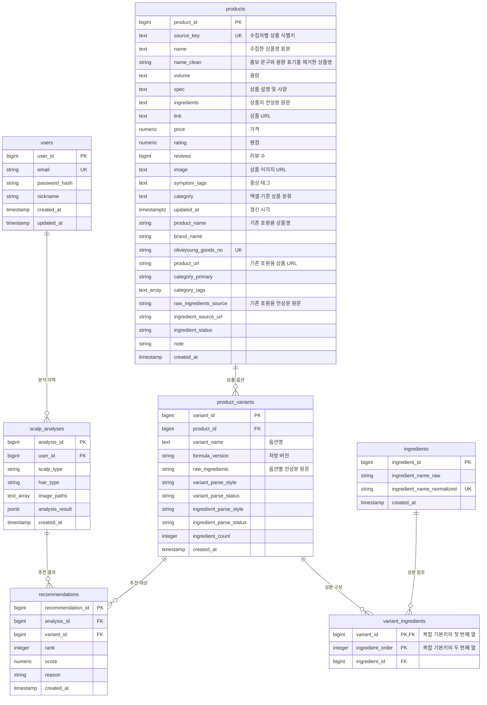

# OliveYoung 333 Direct


## 상품 DB 구축 과정

올리브영에서 수집한 상품 데이터 333행을 정리하고 전성분을 수기로 보완해 초기 상품 DB를 구축했다.
이후 팀원이 제공한 `products.xlsx`를 기준으로 팀원의 요청에 맞춰 기존 DB의 상품 목록을 재정리해 최종 144개 상품을 반영했다.

웹 개발자도구를 사용하여 페이지별 상품정보를 모은 CSV를 병합해서 만든:

```text
oliveyoung_browser_products.csv
```

를 바로 입력으로 쓰는 버전입니다.

따라서:
- Edge 크롤링 코드 없음
- 페이지 병합 코드 없음
- Playwright 없음
- requests 없음
- Cloudflare 관련 코드 없음

## 초기 수집 데이터

`data/input/oliveyoung_browser_products.csv`

- 333행
- goodsNo 333개 고유

## 초기 데이터 전처리

```bat
pip install -r requirements.txt
python run_all.py
```

결과:

```text
01_oliveyoung_333_prepared.csv
02_all_products_classified.csv
02_shampoo_only.csv
03_shampoo_mfds_matched.csv
04_shampoo_manual_all.csv
```

### 04_shampoo_manual_all.csv

실제 샴푸로 판별된 상품만 들어갑니다.

핵심 열:

```text
PRODUCT_NAME
BRAND_NAME
PRODUCT_URL
CATEGORY_PRIMARY
CATEGORY_TAGS
MFDS_MATCH_STATUS
MFDS_CANDIDATE_PRODUCT_NAME
MFDS_MATCH_SCORE
RAW_INGREDIENTS
INGREDIENT_SOURCE_URL
INGREDIENT_STATUS
```

`RAW_INGREDIENTS`에 전성분 전체를 한 셀에 그대로 복붙하세요.

전성분을 입력한 뒤 `python 05_build_db_tables_variant.py`를 실행해
상품, 상품 옵션, 성분, 옵션별 성분 연결 CSV를 생성했다.

## 현재 상품 목록 갱신 방법

현재 DB에 반영할 상품 목록은 `products.xlsx`를 기준으로 관리한다.
상품을 추가하거나 수정할 때는 이 엑셀에 변경 내용을 반영한다.

### 1. CSV 생성 및 검증

`products.xlsx`를 `05_build_db_tables_smart.py`와 같은 폴더에 두고 실행한다.

```bash
python 05_build_db_tables_smart.py
python 06_import_postgres.py --validate-only
```

첫 번째 명령은 `data/output/`에 DB용 CSV와 검토 목록을 생성한다.
두 번째 명령은 DB에 접속하지 않고 생성된 파일을 검증한다.

### 2. Supabase DB 반영

CSV 검증을 마친 뒤, 프로젝트의 Supabase DB에 상품 목록을 반영할 때 실행한다.

```bash
python 06_import_postgres.py
```

실행하면 DB 접속 정보를 입력하라는 메시지가 표시된다.
엑셀에 없는 기존 상품과 옵션은 삭제 대상이 되므로, `products.xlsx`에 유지할 상품 전체가 들어 있는지 확인한 뒤 실행한다.

--------------------------------------------------------

## ERD

## 모발 DB 전체 ERD

사용자별 두피·모발 분석 결과와 상품 옵션별 추천 이력을 관리한다. 상품의 전성분은 옵션별로 구분하며, 각 성분이 원문에 등장한 순서를 함께 저장한다.



### 테이블 역할

| 테이블 | 저장 내용 |
|---|---|
| `users` | 사용자 계정 정보 |
| `scalp_analyses` | 사용자별 두피·모발 분석 결과와 이미지 경로 |
| `recommendations` | 분석 결과별 추천 상품 옵션, 순위, 점수, 추천 이유 |
| `products` | `products.xlsx`에서 가져온 11개 열, 팀원이 추가한 정제 상품명(`name_clean`), 상품 식별 정보, 기존 호환용 정보 |
| `product_variants` | 상품별 옵션명과 처방 버전, 옵션별 전성분 원문, 옵션·성분 파싱 상태 |
| `ingredients` | 성분명 원문과 정규화된 성분명 |
| `variant_ingredients` | 상품 옵션에 포함된 성분과 전성분 원문에서의 표기 순서 |

### 설계상 제약조건

| 대상 | 제약조건 | 의미 |
|---|---|---|
| `products` | `source_key`에 `NOT NULL`과 고유 인덱스 적용 | 수집처별 상품 식별키는 필수이며 같은 키를 중복 저장할 수 없다. |
| `recommendations` | `UNIQUE (analysis_id, variant_id)` | 한 번의 분석 결과에서 같은 상품 옵션을 중복 추천할 수 없다. |
| `product_variants` | `UNIQUE (product_id, variant_name, formula_version)` | 같은 상품에서 옵션명과 처방 버전의 조합은 한 번만 저장할 수 있다. |
| `variant_ingredients` | `PRIMARY KEY (variant_id, ingredient_order)` | 한 옵션의 같은 순서에는 하나의 성분만 저장한다. `ingredient_id`는 성분 사전을 참조하는 외래키다. |
| `product_variants.ingredient_count` | `NULL` 또는 0 이상 | 성분 수에는 음수를 입력할 수 없다. |
| `variant_ingredients.ingredient_order` | 0 초과 | 성분 표기 순서는 1부터 시작한다. |
| `recommendations.rank` | `NULL` 또는 0 초과 | 추천 순위를 기록할 때는 1 이상의 값을 사용한다. |

외래키 삭제 규칙은 `ingredients`와 `variant_ingredients` 사이에 `ON DELETE RESTRICT`를 적용하도록 설계했다. 따라서 옵션에서 참조 중인 성분은 성분 사전에서 삭제할 수 없다. 그 밖에 위 ERD에 표시한 관계는 `ON DELETE CASCADE`로 설계했다.

ERD의 관계선은 설계한 1:N 관계를 나타낸다. 각 외래키 열의 실제 `NOT NULL` 적용 여부는 Supabase 스키마에서 확인할 수 있다.